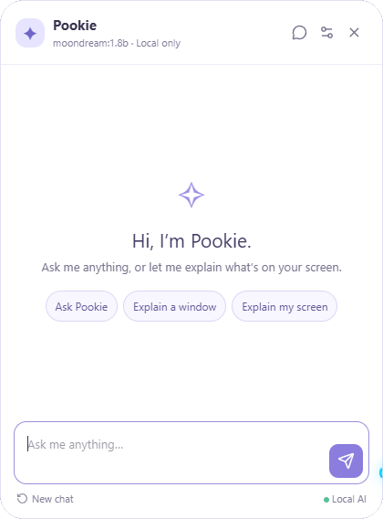
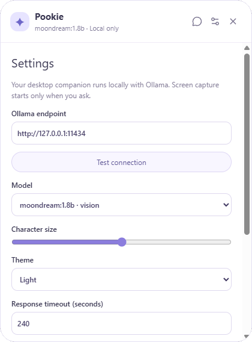
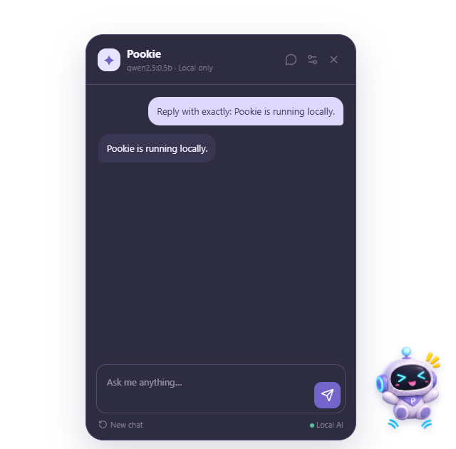

# Pookie

Pookie is an experimental, local-first desktop companion. It floats above your Windows desktop as an animated robot, opens a compact chat panel, and sends questions to an Ollama model running on your own computer. With explicit permission, it can capture the active window or primary monitor and preview that image before sending it to an installed vision model.


The mascot uses a transparent pose atlas derived from the approved Pookie character reference, with lightweight CSS motion and event-driven expressions. See [character animation](docs/character-animation.md) for its states and asset workflow.

## Screenshots

The first two images are cropped from the running **native Windows Tauri overlay**. They show the actual desktop panel and its local Ollama settings.

| Native desktop chat | Native settings |
| --- | --- |
|  |  |

The following images are from a browser integration test of the same Pookie interface against a real, locally running Ollama instance. The test used a temporary Tauri command bridge; these are **not native desktop screenshots**.

| Connected to local Ollama | Live model reply |
| --- | --- |
|  |  |

The reply was streamed from `qwen2.5:0.5b`, a small text-only model. Screen capture needs an installed vision model. The setup below uses `qwen3-vl:2b-instruct` for screen questions.

## Current status

This repository is an early working implementation, **not a finished release**. The React production build and browser integration test with live Ollama pass. A native Windows executable was built in GitHub Actions and launched locally as a visible, responsive Tauri window. The full manual Windows checklist is still pending. See [development notes](docs/development.md) and [limitations](#limitations).

## Requirements

- Windows 10 or 11, with Microsoft Edge WebView2
- Node.js 22 or later and npm
- [Rust](https://www.rust-lang.org/tools/install) stable with the MSVC target (`rustup default stable-x86_64-pc-windows-msvc` on 64-bit Windows)
- [Microsoft C++ Build Tools](https://v2.tauri.app/start/prerequisites/#microsoft-c-build-tools) with **Desktop development with C++** selected in the installer
- [Ollama for Windows](https://ollama.com/download/windows) for local AI

See the [Tauri Windows prerequisites](https://v2.tauri.app/start/prerequisites/#windows) for WebView2 and compiler setup. Install these once before running the commands below. The C++ workload is required to compile the native app.

## Run locally on Windows

These commands open the **native Windows desktop overlay** through Tauri. `npm run dev` starts a web development server alone and will not give you the desktop companion.

1. Install the [requirements](#requirements). Launch **Ollama** from the Start menu and leave it running. Open a new PowerShell terminal and verify its local API:

   ```powershell
   ollama --version
   Invoke-RestMethod http://127.0.0.1:11434/api/version
   ```

   If `ollama` is not recognized, reopen PowerShell after installation. If the API call fails, start Ollama and retry. Pookie connects to `127.0.0.1:11434` by default.

2. Download the models **before** launching Pookie. The first is a quick text-only smoke test; the second understands screenshots. `ollama pull` downloads model files onto your machine and can take several minutes.

   ```powershell
   ollama pull qwen2.5:0.5b
   ollama pull qwen3-vl:2b-instruct
   ollama list
   ```

   For a quick Ollama check, run `ollama run qwen2.5:0.5b "Reply with hello"`. The 0.5B model prioritizes speed over answer quality. For better text answers, use the vision model for both text and screen questions; on CPU, vision replies can still take longer than text. Model latency depends heavily on your hardware.

3. Clone the repository and start its **native Tauri window** in another PowerShell terminal:

   ```powershell
   git clone https://github.com/Irish-Joseph/Pookie-Desktop.git
   cd Pookie-Desktop
   npm ci
   npm run tauri dev
   ```

   The first Rust build can take several minutes. If you see `link.exe not found`, install the C++ Build Tools workload from [Requirements](#requirements), then reopen PowerShell and rerun the last command.

4. Click the floating Pookie mascot on your Windows desktop. In **Settings**, leave the endpoint as `http://127.0.0.1:11434`, click **Test connection**, and select a model. Choose `qwen2.5:0.5b` for fast text chat or `qwen3-vl:2b-instruct` for screen questions. For capture, enable **Allow screen capture when I request it**. Click **Explain my screen** or **Explain a window**, inspect the preview, then press Send. Pookie never sends a screenshot merely because you clicked capture.

5. If a vision answer times out on a CPU-only PC, raise **Response timeout** in Settings (up to 300 seconds) or ask about one focused window. If the model misreads tiny text, capture the active window at a larger on-screen size and ask a specific question. Pookie limits large captures to 1280 pixels on the longest side to keep requests manageable.

Pookie does not install or start Ollama, or download models on your behalf. If you use Ollama in Docker, expose port 11434 on **127.0.0.1** and replace `ollama pull ...` with `docker exec <container-name> ollama pull ...`.

## Build

```powershell
npm ci
npm run check
npm test
cargo test --manifest-path src-tauri/Cargo.toml
npm run tauri build
```

The Windows bundle target is NSIS. Generated files appear under `src-tauri/target/release/bundle/nsis`.

## Privacy

Only numeric loopback Ollama endpoints are accepted. The Rust HTTP client disables proxies and redirects. The webview has no general HTTP plugin permission. Capture is off by default, initiated by the user, previewed in the panel, and kept in memory only. Optional text chat storage uses unencrypted WebView local storage; it is off by default. No telemetry or cloud adapter is included. See [privacy details](docs/privacy.md).

## Limitations

- Windows is the intended initial platform; macOS and Linux have not been tested or packaged.
- Capture currently covers an active window or the primary monitor. Region selection, image import, multi-monitor capture selection, and application exclusions are not implemented.
- Cloud providers, keychain storage, voice, guidance overlays, configurable shortcuts, and full conversation management are not implemented.
- The transparent window is resized with the chat panel; native hit testing of every transparent pixel has not been verified.
- Elevated applications, secure desktops, DRM content, and some fullscreen software may prevent capture.
- The browser UI and native Windows chat and primary-monitor capture have been tested against live Ollama. Tray, drag, active-window capture, and installer behavior still need manual Windows verification. Small vision models can misread dense desktop text; neither speed nor accuracy is guaranteed on all hardware.

See [contributing](CONTRIBUTING.md) and [security](SECURITY.md).

## License

Pookie is open source under the [MIT License](LICENSE). Contributions are welcome through pull requests; the repository owner controls merges to `main`.
