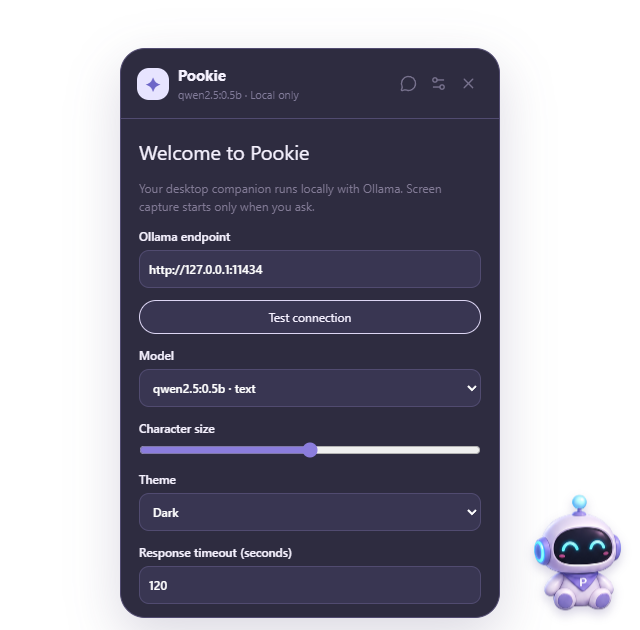

# Pookie

Pookie is an experimental, local-first desktop companion. It floats above your Windows desktop as an animated robot, opens a compact chat panel, and sends questions to an Ollama model running on your own computer. With explicit permission, it can capture the active window or primary monitor and preview that image before sending it to an installed vision model.


The mascot uses a transparent pose atlas derived from the approved Pookie character reference, with lightweight CSS motion and event-driven expressions. See [character animation](docs/character-animation.md) for its states and asset workflow.

## Screenshots

These screenshots are from a browser integration test of the Pookie interface against a real, locally running Ollama instance. The test used a temporary Tauri command bridge; they are **not screenshots of the native desktop overlay**.

| Connected to local Ollama | Live model reply |
| --- | --- |
|  |  |

The reply was streamed from `qwen2.5:0.5b`, which is a small text-only model. Screen capture needs a separate installed model with vision capability. A compact option is `qwen3.5:2b-q4_K_M` (about 1.9 GB to download).

## Current status

This repository is an early working implementation, **not a finished release**. The React production build and browser integration test with live Ollama pass. A native Windows executable was built in GitHub Actions and launched locally as a visible, responsive Tauri window. The full manual Windows checklist is still pending. See [development notes](docs/development.md) and [limitations](#limitations).

## Requirements

- Windows 10 or 11, with Microsoft Edge WebView2
- Node.js 22 or later and npm
- [Rust](https://www.rust-lang.org/tools/install) stable with the MSVC target (`rustup default stable-x86_64-pc-windows-msvc` on 64-bit Windows)
- [Microsoft C++ Build Tools](https://v2.tauri.app/start/prerequisites/#microsoft-c-build-tools) with **Desktop development with C++** selected in the installer
- [Ollama for Windows](https://ollama.com/download/windows) for local AI

See the [Tauri Windows prerequisites](https://v2.tauri.app/start/prerequisites/#windows) for WebView2 and compiler setup. Install these once before running the commands below. The C++ workload is required to compile the native app.

## Run locally

1. Install and start Ollama. In PowerShell, download a small chat model and confirm that Ollama is responding:

   ```powershell
   ollama pull qwen2.5:0.5b
   ollama list
   Invoke-RestMethod http://127.0.0.1:11434/api/version
   ```

2. Clone and launch Pookie in a new PowerShell window:

   ```powershell
   git clone https://github.com/Irish-Joseph/Pookie-Desktop.git
   cd Pookie-Desktop
   npm ci
   npm run tauri dev
   ```

3. In Pookie's Settings, keep the default endpoint `http://127.0.0.1:11434`, select **Test connection**, choose `qwen2.5:0.5b`, and send a chat message. This model handles text only. To explain the screen, install a small vision model:

   ```powershell
   ollama pull qwen3.5:2b-q4_K_M
   ```

   Select `qwen3.5:2b-q4_K_M` in Pookie's Settings, enable screen capture, and use **Explain my screen** or **Explain a window**. Pookie previews the capture before sending it to local Ollama. On a CPU-only machine, allow up to two minutes for the first answer in **Response timeout**.

Pookie does not install or start Ollama, or download models. If Ollama runs in Docker, expose its API on the same loopback address so Pookie can reach it.

## Build

```powershell
npm ci
npm run check
npm test
cargo test --manifest-path src-tauri/Cargo.toml
npm run tauri build
```

The Windows bundle target is NSIS. Generated files appear under `src-tauri/target/release/bundle/nsis`.

## Privacy

Only numeric loopback Ollama endpoints are accepted. The Rust HTTP client disables proxies and redirects. The webview has no general HTTP plugin permission. Capture is off by default, initiated by the user, previewed in the panel, and kept in memory only. Optional text chat storage uses unencrypted WebView local storage; it is off by default. No telemetry or cloud adapter is included. See [privacy details](docs/privacy.md).

## Limitations

- Windows is the intended initial platform; macOS and Linux have not been tested or packaged.
- Capture currently covers an active window or the primary monitor. Region selection, image import, multi-monitor capture selection, and application exclusions are not implemented.
- Cloud providers, keychain storage, voice, guidance overlays, configurable shortcuts, and full conversation management are not implemented.
- The transparent window is resized with the chat panel; native hit testing of every transparent pixel has not been verified.
- Elevated applications, secure desktops, DRM content, and some fullscreen software may prevent capture.
- The browser UI and native Windows chat and primary-monitor capture have been tested against live Ollama. Tray, drag, active-window capture, and installer behavior still need manual Windows verification. Small vision models can misread dense desktop text.

See [contributing](CONTRIBUTING.md) and [security](SECURITY.md).

## License

Pookie is open source under the [MIT License](LICENSE). Contributions are welcome through pull requests; the repository owner controls merges to `main`.
